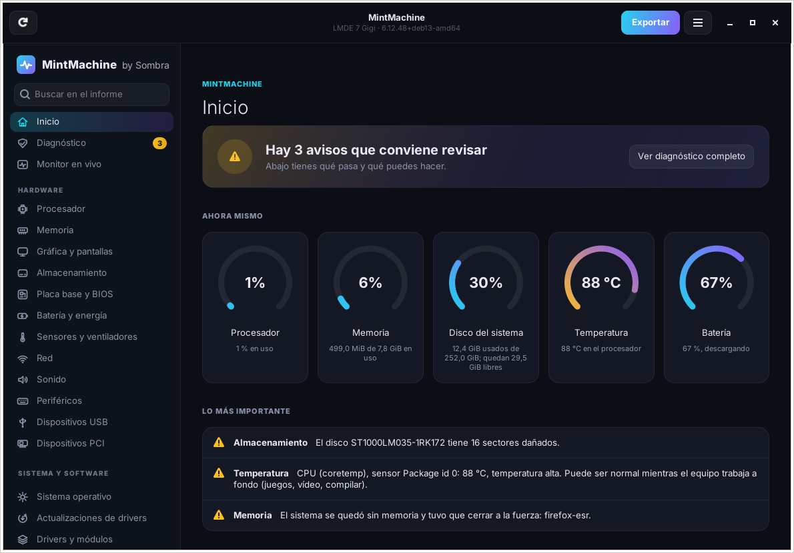
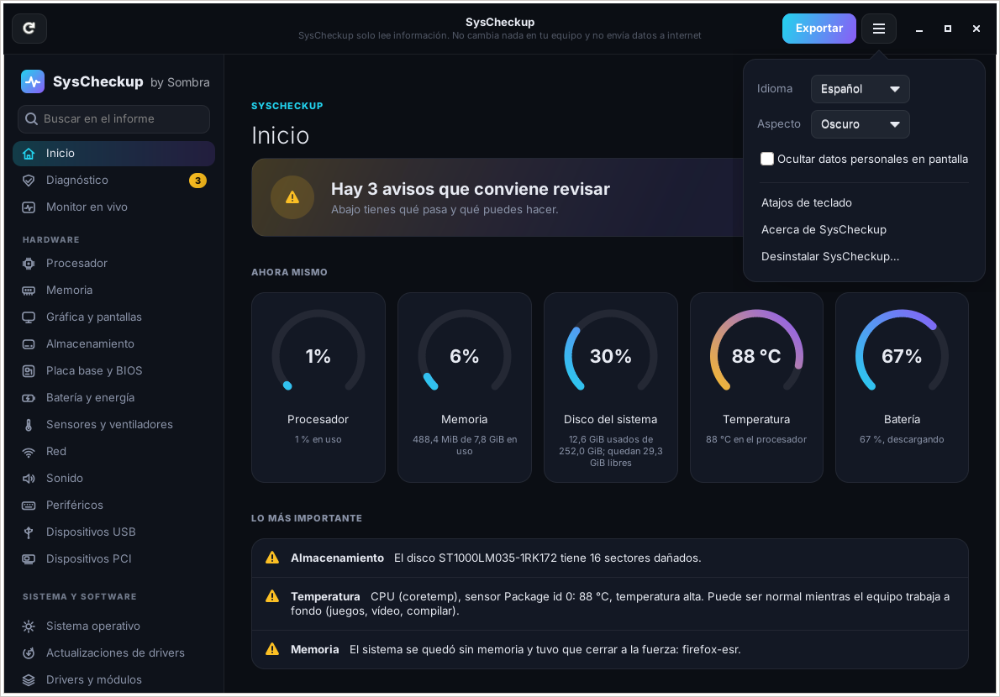
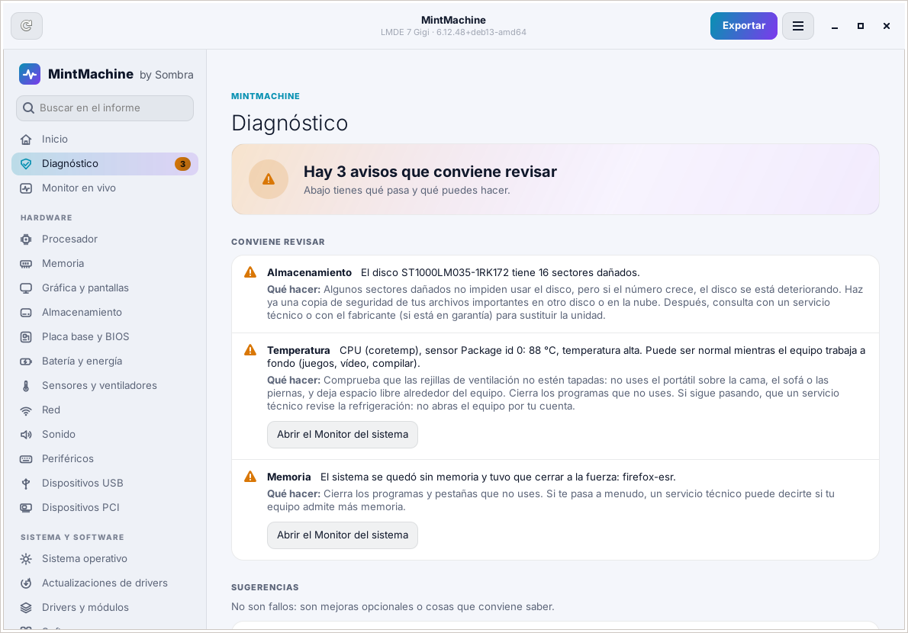
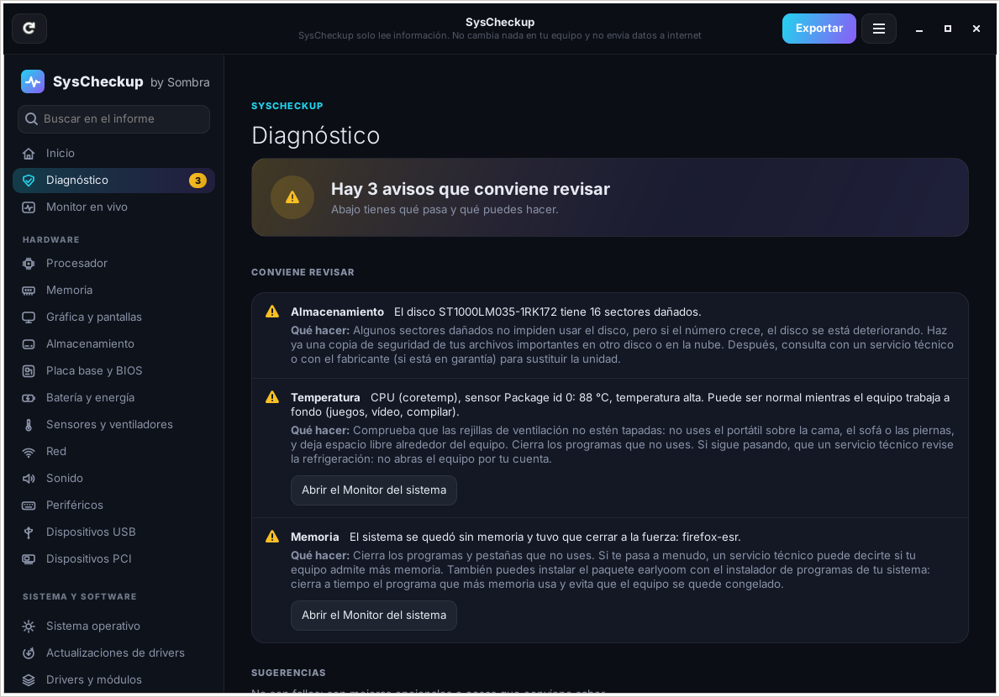
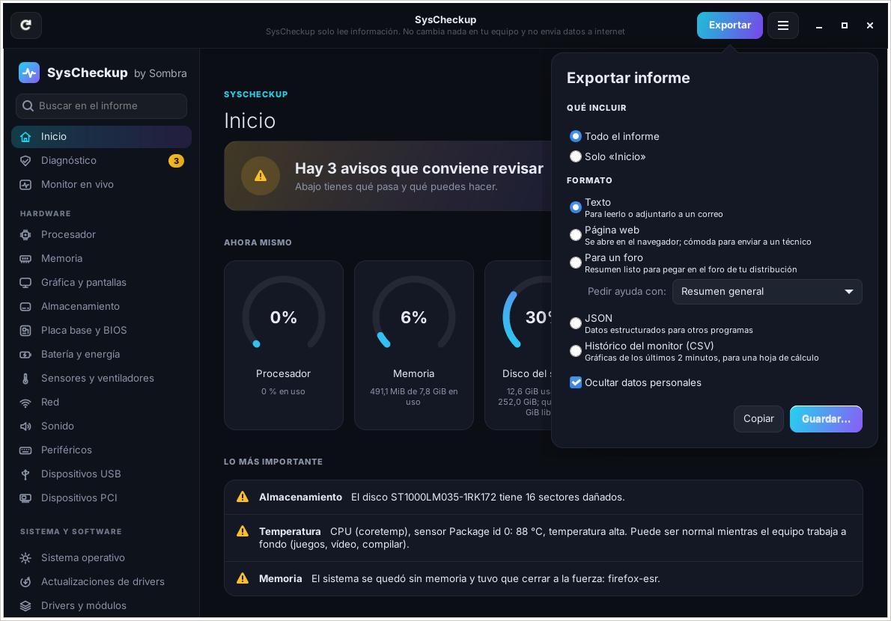
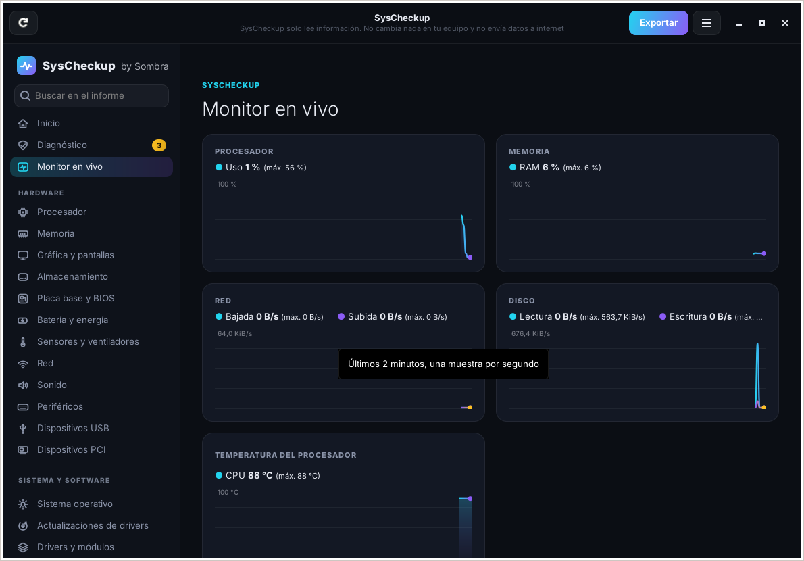
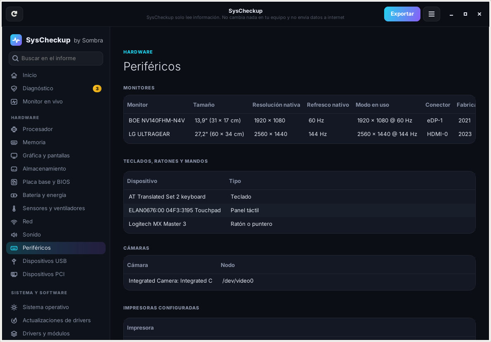

# SysCheckup

[English version](README.md) · [Cambios](CHANGELOG.es.md) · [▶ Vídeo](https://youtu.be/QK0TvLTFIl4)

Hardware, drivers y software de tu equipo Linux en una sola ventana, con gráficas de uso en vivo, revisión de drivers y firmware, un diagnóstico que te señala lo que conviene mirar y pruebas voluntarias de estabilidad y rendimiento.

Funciona en Linux Mint, LMDE, Ubuntu, Debian y cualquier distribución basada en ellas, con cualquier escritorio (Cinnamon, GNOME, KDE Plasma, Xfce, MATE, LXQt…), en X11 y en Wayland. Disponible en español, inglés, francés, japonés y chino.

Autor: José Antonio Ramos Miralles «Sombra» <hola@joseantonioramos.es>. Licencia MIT.



Las capturas de `docs/` salen del banco de pruebas, que simula un portátil. Los datos que aparecen en ellas son inventados.

## Distribuciones y escritorios

SysCheckup solo necesita Python 3 y GTK 3, que traen todas las distribuciones basadas en Debian, y reconoce dónde se está ejecutando:

- **Herramientas del sistema.** Los botones del diagnóstico abren la que esté instalada: en Linux Mint, el Gestor de actualizaciones, el Gestor de controladores y el Gestor de software; en Ubuntu, el Actualizador de software, «Controladores adicionales» y el Centro de aplicaciones; en GNOME, la aplicación Software; en KDE Plasma, Discover; si no hay ninguna, Synaptic. Lo mismo con el monitor del sistema, la configuración de energía, Discos o el analizador de uso de disco de cada escritorio. Si no hay ninguna herramienta gráfica de ese tipo, el consejo lo dice con palabras y no sale botón.
- **Textos.** Los consejos nombran la herramienta que tienes. Los que solo valen para una distribución (los códecs multimedia, el menú de kernels de Linux Mint) cambian según la distribución.
- **Paquetes.** Las pruebas proponen el paquete que exista en tus repositorios (`7zip` o `p7zip-full`; `glmark2-x11`, `glmark2` o `glmark2-wayland`).
- **Pantallas en Wayland.** El modo en uso se pide a GNOME, Cinnamon, KDE Plasma o a los compositores wlroots, como se explica más abajo.

Se ha comprobado con el banco de pruebas haciéndose pasar por LMDE con Cinnamon, Ubuntu con KDE Plasma en Wayland y Debian con Xfce, y con el paquete instalado en Ubuntu 24.04. No se ha probado en cada escritorio real.

## Pensado para cualquiera

- **La primera pantalla enseña lo importante:** si el equipo está bien o hay algo que revisar, indicadores de uso en vivo, la ficha del equipo (con placa base y BIOS) y el estado del sistema.
- **El detalle va en la barra lateral**, agrupado en Hardware y Sistema y software. Lo que solo interesa a expertos está plegado en **Detalles técnicos** dentro de cada sección.
- **Explicaciones en lenguaje llano** bajo los apartados técnicos.
- **Buscador** (Ctrl+F): escribe «temperatura», «NVIDIA» o «batería» y la lista se queda con las secciones que lo mencionan.

## Idioma y aspecto





El programa detecta el idioma del sistema y se abre en él. Se fija solo en el idioma, no en el país: `es_ES`, `es_MX` o `es_AR` → español; `en_US` o `en_GB` → inglés; `fr_FR` o `fr_CA` → francés; `ja_JP` → japonés; `zh_CN` o `zh_TW` → chino (simplificado). Si el sistema está en un idioma que SysCheckup aún no tiene, sale en inglés.

En el menú (☰) se puede elegir otro idioma y el aspecto: oscuro (el de serie), claro o **Sistema**. La elección se guarda en `~/.config/syscheckup/config.json`, el único archivo que el programa crea en tu carpeta personal. Desde la terminal: `syscheckup --idioma en`.

Con **Sistema**, SysCheckup toma los colores de tu escritorio: el fondo y el texto de tu tema (Mint-Y, Adwaita, Yaru, Breeze, Greybird…), tu preferencia de modo claro u oscuro y tu color de acento (el que eliges en Linux Mint con las variantes Aqua, Azul, Naranja… o en GNOME y KDE Plasma en su configuración). Si cambias el tema o pasas de claro a oscuro con el programa abierto, se actualiza al momento. El diseño y los colores que indican estado (bien, aviso, problema) no cambian, y los colores se ajustan si hace falta para que el texto se lea bien. Si tu tema no tiene variante oscura y pides modo oscuro, se usa el oscuro de SysCheckup con tu color de acento.

La ventana usa el icono del lanzador del menú: si lo cambias con el editor del menú, la ventana también cambia. Además del icono de color se instala uno monocromo, `syscheckup-symbolic`, por si prefieres ese.

Las traducciones son archivos `.po` normales en la carpeta `po/`; se pueden revisar con Poedit o Weblate. Las ha hecho una IA: conviene que las revise alguien nativo, sobre todo las de japonés y chino. Para ver bien el japonés y el chino hacen falta fuentes con esos caracteres (paquete `fonts-noto-cjk`, que Linux Mint instala al añadir esos idiomas).

## Recomendaciones seguras

SysCheckup solo lee información: no cambia nada en el equipo. El diagnóstico explica qué pasa y qué hacer, y solo propone acciones seguras desde el propio sistema: instalar actualizaciones, abrir el Gestor de controladores, hacer una copia de seguridad, liberar espacio… Cuando un aviso tiene una herramienta del sistema asociada, aparece un botón para abrirla.

Nunca pide abrir el equipo ni tocar componentes. Si algo requiere una revisión física (limpieza interna, cambiar un disco, la memoria o la batería), la recomendación es acudir a un servicio técnico o al fabricante. Este aviso aparece también en el Diagnóstico, en «Acerca de» y en los informes exportados.



## Qué muestra

Veintiuna secciones en la barra lateral:

| Sección | Contenido |
|---|---|
| Inicio | Estado general, indicadores en vivo (procesador, memoria, disco, temperatura, batería), lo más importante del diagnóstico, ficha del equipo con placa base y BIOS, y sistema |
| Diagnóstico | Revisión automática: qué conviene revisar, sugerencias opcionales, qué hacer en cada caso y errores más repetidos del registro del sistema |
| Monitor en vivo | Gráficas de los últimos dos minutos de procesador, RAM y swap, red, disco, temperatura y gráfica; uso de cada hilo; programas que usan la gráfica; máximos alcanzados desde que abriste el programa; procesos que más consumen |
| Procesador | Indicadores en vivo de uso total, frecuencia media y temperatura, con una barra por hilo que se actualiza cada segundo; modelo, familia y stepping, microcódigo, núcleos e hilos, núcleos P y E, cachés, juegos de instrucciones, frecuencia y uso de cada hilo, frenazos por temperatura, vulnerabilidades y mitigaciones. Con tu contraseña, si lo pides: frecuencia base y multiplicadores, estados de rendimiento y consumo en vatios. Pruebas voluntarias de estabilidad y de rendimiento |
| Placa base y BIOS | Fabricante y modelo del equipo y de la placa, versión y fecha de la BIOS, UEFI o legacy, Secure Boot, TPM |
| Memoria | Uso de RAM y swap, módulos instalados ranura a ranura con su fabricante (si la placa no lo da, se deduce del código JEDEC o de la referencia del módulo), ranuras libres, máximo que admite la placa, errores de memoria corregidos, protección ante falta de memoria. Con tu contraseña, si lo pides: tiempos, perfiles XMP, fabricante de los chips y fecha de fabricación, leídos de los propios módulos. Prueba voluntaria de la memoria |
| Gráfica y pantallas | Tarjetas, driver en uso, frecuencia, temperatura, consumo y su límite, qué la está limitando (consumo, temperatura…), BIOS de la tarjeta, memoria de vídeo y su fabricante, Resizable BAR, enlace PCIe, OpenGL y Vulkan, formatos de vídeo que decodifica por hardware, monitores y modo en uso. Pruebas voluntarias de rendimiento y de carga sostenida |
| Almacenamiento | Espacio ocupado; salud SMART, desgaste de los SSD, temperatura y horas de uso; evolución de la salud de cada disco día a día; unidades con modelo, tipo, interfaz, enlace PCIe y firmware; particiones y cifrado; TRIM. Prueba voluntaria de velocidad |
| Red | Interfaces con driver, MAC, IP y velocidad; Wi-Fi con calidad de la señal y banda; puerta de enlace, DNS, Bluetooth |
| Sonido | Tarjetas de sonido y servidor de audio |
| Dispositivos USB | Lo que hay conectado, con velocidad, consumo y driver |
| Dispositivos PCI | Todos los dispositivos y el driver que usa cada uno |
| Periféricos | Monitores (marca, modelo, tamaño, resolución y refresco nativos, modo en uso, año de fabricación y número de serie, leídos del EDID del propio monitor), teclados, ratones, paneles táctiles, mandos, cámaras, impresoras y dispositivos Bluetooth emparejados |
| Sensores y ventiladores | Temperaturas, ventiladores en RPM y en porcentaje, quién los controla, curvas programadas, umbrales térmicos del firmware, voltajes y potencia |
| Batería y energía | Carga, salud frente a la capacidad de fábrica, ciclos, consumo, límite de carga, tipo de suspensión, hibernación; batería de ratones y teclados inalámbricos; SAI (UPS) conectados por USB; fuentes de alimentación con USB (Corsair HXi, RMi, AXi) |
| Sistema operativo | Distribución y base, fecha de instalación, kernel, escritorio, duración del arranque y qué lo retrasa |
| Drivers y módulos | Módulos del kernel cargados, cuáles son privativos o externos, DKMS, marcas del kernel |
| Actualizaciones de drivers | Versión instalada y disponible de kernel, driver NVIDIA, Mesa, firmware, microcódigo y DKMS; firmware de BIOS, SSD y periféricos; dispositivos sin driver; firmware que falta. En Ubuntu y Linux Mint 22, las actualizaciones que llegan por fases se muestran aparte y no cuentan como pendientes |
| Software | Paquetes instalados, versiones de los componentes clave, actualizaciones pendientes, últimos cambios, Flatpak, programas de inicio, repositorios |
| Seguridad | Secure Boot, TPM, nivel de seguridad del firmware (HSI), cifrado de disco, cortafuegos, AppArmor, puertos abiertos, SSH |
| Puesta a punto | Lista de comprobación de lo que conviene dejar hecho tras instalar el sistema: actualizaciones, drivers y firmware, cortafuegos, instantáneas de Timeshift, TRIM de los SSD y códecs multimedia. Cada punto lleva a la herramienta del sistema que lo hace |


## Pruebas voluntarias

Las pestañas Procesador, Memoria, Gráfica y pantallas y Almacenamiento tienen al final un apartado **Pruebas voluntarias**. Ninguna prueba se hace sola: hay que pulsar el botón, leer el aviso, marcar la casilla «He leído el aviso y quiero hacer la prueba» y pulsar **Empezar**.

| Prueba | Qué hace | Utilidad que usa |
|---|---|---|
| Estabilidad del procesador (1, 10 o 60 min) | Todos los núcleos al máximo con cálculos variados, comprobando que los resultados son correctos | `stress-ng` (sin él, una prueba ligera en Python que detecta menos) |
| Rendimiento del procesador (2–3 min) | Puntuación comprimiendo y descomprimiendo, con un núcleo y con todos | `7z b` (paquete `7zip`) |
| Memoria (1, 10 o 30 min) | Escribe y comprueba patrones en la mitad de la memoria libre | `stress-ng` |
| Rendimiento de la gráfica (unos 5 min) | Escenas 3D en una ventana y una puntuación | `glmark2` |
| Carga sostenida de la gráfica (1, 10 o 30 min) | Mantiene la gráfica trabajando para ver si es estable | `glmark2` |
| Velocidad del disco | Escribe 1 GiB en tu carpeta personal, lo lee y lo borra | `dd` |

Mientras dura, una ventana muestra el tiempo que queda, la temperatura y su gráfica, la frecuencia y el uso, con un botón **Detener**. La prueba se para sola si:

- la temperatura del procesador llega a 5 °C del máximo que declara (90 °C en AMD y 95 °C en Intel si no lo declara), o la de la gráfica a 10 °C de su máximo (87 °C si no lo declara);
- el portátil se desconecta de la corriente (con batería no deja empezar, ni con menos del 30 % de carga);
- se cierra SysCheckup.

Cada prueba va en su propio grupo de procesos y lleva además su propio límite de tiempo, para que nunca se quede funcionando sola. Al terminar se ve el resultado: superada, con errores (fallos de cálculo o errores de hardware nuevos en el registro del kernel), detenida por temperatura… con la temperatura máxima, la frecuencia sostenida y las veces que el procesador se frenó por calor. Las puntuaciones se comparan con tus mediciones anteriores; SysCheckup no envía nada a internet, así que no hay comparación con otros equipos.

Los resultados se guardan en `~/.config/syscheckup/historial.json` y aparecen en la tabla «Pruebas que has hecho» de cada pestaña y en los informes exportados.

## Datos internos de la memoria y del procesador

Todo lo que el sistema deja leer a tu usuario se lee sin contraseña, y solo hay que darla para lo que de verdad la necesita:

- **Sin contraseña:** la frecuencia base, la máxima y la mínima del procesador con sus multiplicadores (de `cpufreq`); los datos de los módulos de memoria cuando el kernel ya los publica (los drivers `ee1004` y `spd5118` se cargan solos en muchas placas, y entonces sus datos los puede leer cualquier usuario); y el consumo del procesador en vatios, en vivo, si tu sistema deja leer sus contadores.
- **Con contraseña:** solo lo que falta. En la pestaña Memoria el botón aparece únicamente si tu sistema no publica los datos de los módulos. En la pestaña Procesador, únicamente si queda algo que solo el administrador puede leer: el consumo en vatios (desde Linux 5.10, por seguridad, sus contadores son solo del administrador) y, en AMD, los estados de rendimiento.

Junto a cada botón de prueba y de datos internos hay una «i»: al pulsarla explica qué hace, cuánto dura, qué utilidad usa, si pide contraseña y cuándo se detiene sola.

El botón **Leer datos internos…** (al pulsarlo, el sistema te pide la contraseña) lee lo que guardan los propios componentes y que el sistema solo enseña al administrador:

- **Memoria (SPD):** fabricante del módulo y de sus chips, referencia, fecha de fabricación, velocidad y tiempos de serie (CL-tRCD-tRP-tRAS) y los perfiles del fabricante (XMP). Si la memoria funciona a la velocidad estándar y sus perfiles permiten más, lo indica. Funciona con DDR4 y DDR5 cuando la placa publica estos datos al sistema (drivers `ee1004` y `spd5118` del kernel; en Ubuntu 24.04 la DDR5 necesita el kernel HWE).
- **Procesador:** frecuencia base y multiplicadores, estados de rendimiento (AMD) y turbo máximo (Intel), y el consumo del procesador en vatios medido durante un segundo.

Lo hace un ayudante aparte, `/usr/libexec/syscheckup/syscheckup-probe`, que se lanza con `pkexec` solo cuando pulsas el botón. Solo lee: copia los datos que publican los drivers del kernel, sin usar `/dev/i2c-*` ni escribir en el bus de la memoria, lee una lista cerrada de registros del procesador y no admite otros argumentos. Si tiene que cargar un módulo del kernel (`ee1004`, `spd5118` o `msr`), lo descarga al terminar. Los datos de la memoria solo se muestran si superan su suma de control.

Las posiciones de cada dato en el chip SPD siguen las normas JEDEC y se han contrastado con `decode-dimms` (DDR4) y con memtest86+ (DDR4 y DDR5, perfiles XMP). La DDR5 y los perfiles XMP no se han podido probar todavía con módulos reales.

## Exportar

Un solo botón, **Exportar**, con todas las opciones:



- **Qué incluir:** todo el informe o solo la sección que estás viendo.
- **Formato:**
  - **Texto**, para leerlo o adjuntarlo a un correo.
  - **Página web**, que se abre en el navegador y es cómoda para enviar a un técnico.
  - **Para un foro**, un resumen entre `[code]` y `[/code]` listo para pegar en el foro de Linux Mint. En «Pedir ayuda con» puedes elegir el problema (Wi-Fi y red, sonido, gráfica y pantallas, batería y temperatura, lentitud y arranque): el resumen lleva entonces la ficha del equipo y solo las secciones que hacen falta para ese problema, con sus detalles técnicos.
  - **JSON**, para procesar los datos con otro programa.
  - **Histórico del monitor (CSV)**, las gráficas de los últimos dos minutos para abrirlas en una hoja de cálculo.
- **Ocultar datos personales**, marcado por defecto: tapa números de serie, MAC, IP, UUID de los discos, nombre del equipo, red Wi-Fi, usuario y nombres de dispositivos Bluetooth, también cuando aparecen dentro de otros textos, como el registro del sistema.
- **Copiar** al portapapeles o **Guardar** en un archivo. Después de guardar sale un botón para abrirlo.

Los informes incluyen siempre todo, también lo que en la ventana está plegado en «Detalles técnicos».

Si solo quieres un dato, puedes marcar cualquier texto de la ventana con el ratón (o con doble clic) y copiarlo con Ctrl+C. En las tablas se marcan filas enteras (con Mayús o Ctrl, varias) y Ctrl+C las copia separadas por tabuladores, listas para pegar en una hoja de cálculo.

## Botones y atajos

| | |
|---|---|
| Flecha circular, F5 o Ctrl+R | Volver a leer todo el equipo |
| Ctrl+F | Buscar en todo el informe |
| Ctrl+E | Exportar |
| Alt+1 … Alt+9 | Ir a una de las primeras nueve secciones de la lista |
| Menú (☰) | Idioma, aspecto (oscuro, claro o Sistema), ocultar datos personales en pantalla (para hacer capturas), atajos de teclado, Acerca de y Desinstalar |
| F1 | Acerca de |
| Ctrl+Q | Salir |

## Monitor en vivo



SysCheckup toma una muestra por segundo desde que arranca y guarda los últimos dos minutos. Las gráficas se dibujan con datos reales del kernel:

- **Procesador:** uso total y una barra por hilo, calculados con `/proc/stat`.
- **Memoria:** RAM ocupada de verdad (total menos disponible) y swap.
- **Red:** bajada y subida sumando las interfaces físicas.
- **Disco:** lectura y escritura de todas las unidades, con `/proc/diskstats`.
- **Temperatura del procesador:** el sensor más caliente de la CPU.
- **Gráfica:** uso de la GPU en tarjetas AMD, NVIDIA e Intel. Intel no publica un porcentaje, así que se calcula con el tiempo que la gráfica pasa dormida (RC6); en los portátiles con dos gráficas salen las dos líneas.
- **Programas que usan la gráfica:** el kernel publica en `/proc/<pid>/fdinfo` el tiempo de gráfica de cada programa (AMD, Intel y el driver libre de NVIDIA); con el driver privativo de NVIDIA lo da `nvidia-smi pmon`. Solo salen tus propios programas.
- **Máximos de la sesión:** lo más alto que han llegado el uso y la temperatura del procesador, la memoria y la gráfica desde que abriste SysCheckup, con la hora.

Cada gráfica muestra el valor actual y el máximo de los dos últimos minutos. Debajo van dos tablas con los procesos que más procesador y más memoria gastan, y la presión del sistema (PSI): el porcentaje de tiempo que los programas pasan esperando CPU, memoria o disco.

## Monitores y fuente de alimentación



Los datos del monitor salen de su EDID, la ficha que el propio monitor envía por el cable. El kernel la publica en `/sys/class/drm`; con el driver privativo de NVIDIA no siempre lo hace, y entonces SysCheckup la lee de `xrandr --verbose`.

La fuente de alimentación de un sobremesa no comunica al equipo su marca, modelo ni potencia, así que ningún programa puede leerlos. Las únicas que lo hacen son las fuentes «inteligentes» con cable USB interno; de ellas, Linux tiene driver para las Corsair HXi, RMi y AXi (`corsair-psu`), y SysCheckup muestra su modelo, la potencia que entregan, la temperatura y el ventilador. Para saber cuál es la tuya, mira la factura o la caja; no abras el equipo para leer la etiqueta.

## Ventiladores y curvas

Esto es lo que Linux permite saber de un ventilador, y SysCheckup lo enseña todo:

| Dato | De dónde sale | Disponibilidad |
|---|---|---|
| Velocidad en RPM | `fanN_input` | Casi siempre, si el kernel tiene driver para el chip |
| Potencia en % | `pwmN`, de 0 a 255 | Placas de sobremesa y bastantes portátiles |
| Quién lo controla | `pwmN_enable`: 0 al máximo, 1 manual, 2 o más automático | Donde haya `pwmN` |
| Curva temperatura → potencia | `pwmN_auto_pointM_temp` y `_pwm` | Solo si el chip la publica |
| Umbrales del firmware | Zonas térmicas ACPI | Casi todos los portátiles |

La curva que configuras en la BIOS se guarda en el chip controlador de la placa y la mayoría de drivers no deja leerla. SysCheckup la muestra cuando existe: algunas placas con chips Nuvoton o ITE, los portátiles ASUS ROG con curvas personalizadas y las gráficas AMD. En el resto de equipos verás los umbrales ACPI, que dicen a qué temperatura el firmware acelera el ventilador, frena el procesador o apaga el equipo.

SysCheckup solo lee. Para cambiar curvas desde Linux están CoolerControl, con interfaz gráfica, y `fancontrol`, del paquete `lm-sensors`.

## Cómo se comprueba si los drivers están al día

En Windows cada driver se instala y se actualiza por separado. En Linux casi todos viajan dentro del kernel, así que la pregunta útil es otra: si tienes el kernel más reciente que ofrece tu distribución. SysCheckup revisa cuatro cosas.

1. **Paquetes.** Compara la versión instalada con la que ofrecen tus repositorios para el kernel, el driver de NVIDIA, Mesa, los paquetes de firmware, el microcódigo del procesador y los módulos DKMS.
2. **Firmware de dispositivos.** Si está `fwupd`, lista BIOS, SSD, docks y periféricos con su versión y avisa cuando el fabricante ha publicado una nueva.
3. **Dispositivos sin driver.** Señala el hardware PCI que no tiene ningún módulo cargado.
4. **Firmware que falta.** Busca en el registro del kernel los archivos que un driver pidió y no encontró, y dice de qué dispositivo son y qué paquete los trae. No avisa por los que ninguna distribución incluye porque son opcionales, como `iwl-debug-yoyo.bin` del Wi-Fi Intel.

También avisa si ya tienes un kernel más nuevo instalado y falta reiniciar, y si la lista de paquetes lleva más de diez días sin refrescarse.

La comparación se hace con los repositorios de tu sistema y sin conectar a internet. Si NVIDIA publica hoy un driver que Debian aún no ha empaquetado, SysCheckup no lo sabrá.

## Diagnóstico

Además de leer, interpreta. Avisa de:

- Discos por encima del 90 % de ocupación, con sectores dañados, con fallo SMART inminente o con la vida útil estimada casi agotada.
- Errores de disco, errores de hardware del procesador y cierres por falta de memoria en el registro del kernel.
- Temperaturas altas y frenazos del procesador por calor.
- Batería desgastada.
- Servicios de systemd que no arrancaron bien.
- Un solo módulo de RAM en una placa con dos ranuras, y errores de memoria.
- Gráfica sin driver o 3D dibujado por software.
- Vulnerabilidades de CPU sin mitigar.
- Señal Wi-Fi débil.
- Versiones nuevas de drivers y firmware, actualizaciones pendientes y reinicios sin hacer.

Cada aviso dice qué hacer y, si existe, ofrece un botón para abrir la herramienta del sistema: Gestor de actualizaciones, Gestor de controladores, Copias de seguridad, Timeshift, Analizador de uso de disco, Discos, Cortafuegos, Firmware, Monitor del sistema o Informes del sistema. El botón solo aparece si la herramienta está instalada. SysCheckup nunca ejecuta nada como administrador: si la herramienta necesita permisos, es ella la que pide la contraseña.

Si un aviso no te interesa, pulsa **Ocultar este aviso**: deja de salir en el Diagnóstico y en el Inicio, y no cuenta en el número de la barra lateral. Si el problema cambia (por ejemplo, el disco pasa del 91 % al 95 %), vuelve a salir. Arriba del Diagnóstico se indica cuántos has ocultado, con un botón para volver a mostrarlos. Los informes que exportas siguen incluyéndolos todos.

## Desinstalar

Menú (☰) → **Desinstalar SysCheckup…**. Quita el programa, su icono del menú, su configuración y su historial, sin dejar rastro. El sistema pide tu contraseña, como en cualquier desinstalación. Los informes que hayas guardado son tuyos y no se tocan.

Desde la terminal hace lo mismo: `sudo apt purge syscheckup` y después `rm -rf ~/.config/syscheckup ~/.cache/syscheckup`.

## Instalación

Descarga el `.deb` y, desde la carpeta donde lo hayas guardado:

```
sudo apt install ./syscheckup_0.8.0_all.deb
```

`apt` instala las dependencias que falten. Después lo tienes en el menú con el nombre SysCheckup. Si tenías una versión anterior, este paquete la actualiza; si tenías una de las versiones de prueba que se llamaban MintMachine, o la primera, que se llamaba Radiografía, la sustituye. La configuración y el historial de MintMachine se trasladan solos a la carpeta nueva.

Para quitarlo, mira la sección «Desinstalar».

### Sin instalar

El programa es un único archivo de Python:

```
python3 syscheckup.py
```

Necesita `python3-gi`, `python3-gi-cairo` y `gir1.2-gtk-3.0`, que Mint y LMDE traen de serie.

## Uso desde la terminal

```
syscheckup                       abre la ventana
syscheckup --texto               informe completo por terminal
syscheckup --foro                resumen para pegar en un foro, con los datos personales ocultos
syscheckup --foro --problema red resumen centrado en un problema: red, sonido, grafica, energia o lentitud
syscheckup --txt informe.txt     guarda el informe completo en texto
syscheckup --html informe.html   guarda el informe en HTML
syscheckup --json                vuelca los datos en JSON
syscheckup --csv monitor.csv     mide dos minutos y guarda el histórico del monitor
syscheckup --texto --anon        cualquiera de las anteriores con --anon oculta los datos personales
syscheckup --idioma en           cualquiera de las anteriores en otro idioma (es, en, fr, ja, zh)
syscheckup --texto --debug       muestra además qué utilidades se ejecutan y cuánto tarda cada una
```

Sin entorno gráfico, por ejemplo por SSH, el programa pasa solo al modo texto.

## Privacidad

SysCheckup no abre ninguna conexión a internet. Lee archivos de `/proc` y `/sys` y ejecuta utilidades que ya están en tu sistema. Solo pide la contraseña de administrador si eliges «Leer datos internos» o «Desinstalar». Los informes se quedan donde tú los guardes.

Al exportar, «Ocultar datos personales» viene marcado. Revisa igualmente el informe antes de publicarlo: la ocultación busca los datos que el programa conoce y los formatos habituales (MAC, IP, UUID), pero no puede adivinar cualquier dato personal que aparezca en un nombre de archivo o de dispositivo.

Lo que garantiza el código, y comprueban las pruebas automáticas en cada cambio:

- No importa ningún módulo de red. La única función de red que usa es la que devuelve el nombre del equipo.
- En tu carpeta personal solo escribe dentro de `~/.config/syscheckup/`: `config.json` (idioma y tema) e `historial.json` (una medición diaria de la salud de cada disco, los resultados de las pruebas que hagas y los datos internos que leas). Los discos se identifican con una huella, no con su número de serie. La prueba de velocidad del disco crea un archivo temporal en `~/.cache/syscheckup/` y lo borra al terminar.
- Solo pide la contraseña si tú eliges «Leer datos internos» o «Desinstalar». El ayudante que usa para los datos internos solo lee.
- `--debug` escribe en la terminal el nombre de cada utilidad y sus opciones, nunca sus argumentos ni su salida, y no crea ningún archivo.
- De la configuración de Timeshift solo mira si hay instantáneas programadas; del escritorio en Wayland, solo el conector y el modo de cada pantalla.
- Con «Ocultar datos personales» se tapan también los nombres de las impresoras y los de los teclados y ratones Bluetooth, que pueden llevar el nombre de una persona.

## De dónde sale cada dato

| Dato | Fuente |
|---|---|
| Procesador | `/proc/cpuinfo`, `/proc/stat`, `/sys/devices/system/cpu` |
| Placa y BIOS | `/sys/class/dmi/id` |
| Secure Boot, TPM | `/sys/firmware/efi/efivars`, `/sys/class/tpm` |
| Módulos de RAM | `udevadm info` sobre el nodo DMI, sin root |
| Datos internos de la memoria | `/sys/bus/i2c/drivers/ee1004/*/eeprom` y `…/spd5118/*/eeprom`, con el ayudante y tu contraseña |
| Multiplicadores y consumo del procesador | Registros MSR (`/dev/cpu/0/msr`) y `/sys/class/powercap/intel-rapl:*/energy_uj`, con el ayudante y tu contraseña |
| Límites, temperatura y consumo de la gráfica | AMD: `/sys/class/drm/card*/device/gpu_metrics` y `hwmon`; NVIDIA: `nvidia-smi` |
| Resizable BAR | Tamaño de las ventanas de memoria PCI de la tarjeta (`resource`) frente a su memoria de vídeo |
| Protección ante falta de memoria | `systemctl is-active` de systemd-oomd, earlyoom y nohang |
| Gráfica y vídeo | `lspci`, `glxinfo`, `vainfo`, `vulkaninfo`, `nvidia-smi` |
| Monitores | EDID en `/sys/class/drm` o, con NVIDIA, `xrandr --verbose` |
| Modo de pantalla en uso | X11: `xrandr`. Wayland: D-Bus del escritorio (GNOME, Cinnamon), `kscreen-doctor -j` (KDE), `wlr-randr --json` (wlroots) |
| Uso de la gráfica Intel | `/sys/class/drm/card*/gt/gt0/rc6_residency_ms` (i915) o `…/gtidle/idle_residency_ms` (xe) |
| Aplicación de cada proceso | `/proc/<pid>/cgroup` y el nombre del ejecutable |
| Perfil y gobernador de energía | `powerprofilesctl`, `/sys/firmware/acpi/platform_profile`, `/sys/devices/system/cpu/*/cpufreq` |
| Memoria comprimida | `/sys/block/zram*`, `/sys/module/zswap` |
| Seguridad del firmware (HSI) | Propiedad `HostSecurityId` del servicio fwupd, con `gdbus` |
| Puesta a punto | Datos de las demás secciones y `/etc/timeshift/timeshift.json` |
| Fuente de alimentación | `/sys/class/hwmon` (driver `corsair-psu`) |
| Discos | `lsblk`, `statvfs`, `/proc/diskstats` |
| SMART | `udisksctl dump`: el servicio UDisks ya tiene los datos leídos y los ofrece sin root |
| Desgaste de los SSD | `gdbus call` a `SmartGetAttributes` de UDisks (NVMe y SATA) |
| Enlace PCIe, frecuencia de la gráfica | `/sys/bus/pci/devices/*/current_link_*`, `/sys/class/drm/card*` |
| Red | `/sys/class/net`, `ip`, `iw` |
| Sensores y ventiladores | `/sys/class/hwmon`, `/sys/class/thermal`, `/proc/acpi/ibm/fan` |
| Batería y suspensión | `/sys/class/power_supply`, `/sys/power` |
| Procesos | `/proc/<pid>/stat` |
| Módulos del kernel | `/proc/modules`, `/sys/module`, `dkms` |
| Versiones de drivers | `dpkg-query`, `apt-cache policy` |
| Firmware | `fwupdmgr get-devices` y `get-updates` |
| Software | `apt`, `flatpak`, `/var/log/dpkg.log` |
| Servicios y registro | `systemctl`, `systemd-analyze`, `journalctl` |

Si falta alguna utilidad, la sección correspondiente sale más corta y el resto sigue funcionando. Un fallo al leer una sección tampoco tumba las demás.

## Estado del proyecto

Versión 0.8.0. Conviene saber cómo se ha probado.

El código se ha ejecutado en una máquina virtual con Ubuntu 24.04, en un contenedor con los paquetes de LMDE 7 y contra un portátil simulado: un `/sys` falso con placa, batería, sensores, ventiladores con PWM y curva, monitor, Wi-Fi y USB, más versiones de pega de `lspci`, `lsblk`, `udisksctl`, `gdbus`, `fwupdmgr`, `apt-cache` y compañía. Con eso se han comprobado todos los analizadores, las gráficas con carga real de CPU y disco, el refresco en vivo, la búsqueda, los botones, la ocultación de datos personales y los cinco formatos de exportación.

Lo que falta es rodaje en hardware real. Los formatos del banco de pruebas están escritos a mano a partir de la documentación de cada herramienta, y un equipo de verdad siempre trae alguna rareza. Si una sección sale vacía o con datos raros en tu máquina, abre una incidencia y pega el resultado de `syscheckup --texto --anon`.

### Límites conocidos

- **Curvas de la BIOS.** Solo se ven cuando el driver del chip las publica. Está explicado más arriba.
- **Drivers más nuevos que los del repositorio.** La comparación no sale de tu sistema.
- **SMART y desgaste de los NVMe.** Necesita UDisks 2.10 o posterior. Linux Mint 22 y LMDE 7 lo traen; LMDE 6 trae la 2.9 y solo dará SMART de discos SATA.
- **Traducciones hechas por IA.** Inglés y francés deberían ser correctos; japonés y chino conviene que los revise alguien nativo.
- **Desgaste de los SSD sin probar en hardware real.** La respuesta de UDisks está escrita a partir de su documentación. Si en tu SSD la columna «Vida útil» sale vacía, abre una incidencia.
- **SAI y actualizaciones por fases.** Se han probado con respuestas simuladas de UPower y de apt, no con un SAI real ni en un Ubuntu real.
- **Detalle de SMART.** Se muestra estado, temperatura, horas y sectores dañados. La tabla completa de atributos sigue pidiendo `sudo smartctl -a`.
- **Registro del kernel.** Para leerlo, tu usuario debe pertenecer al grupo `adm`. El primer usuario de Mint suele estar.
- **Uso de la GPU en Intel.** Es una estimación a partir del tiempo de reposo de la gráfica, sin probar todavía en hardware real.
- **Datos internos de la memoria.** Dependen de que la placa publique el SPD al sistema; muchas sí, algunas no. La lectura de DDR4 está contrastada con `decode-dimms`; la de DDR5 y los perfiles XMP siguen las posiciones de memtest86+ y aún no se han probado con módulos reales. Los perfiles EXPO se detectan, pero sus tiempos no se leen.
- **Multiplicadores del procesador.** Se leen en AMD Ryzen (Zen 1 a Zen 5) e Intel. No se muestra el voltaje que pide el procesador: su codificación cambia según la generación y no está verificada.
- **Motivos de límite de la gráfica.** En AMD solo para las versiones de `gpu_metrics` que SysCheckup conoce (las de las gráficas Radeon de consumo y las integradas recientes); en las demás no sale la fila.
- **Pruebas.** Las de estrés y rendimiento se han probado en una máquina virtual sin sensores de temperatura y con la gráfica por software; el corte por temperatura y el de batería se han probado con datos simulados.
- **Wayland.** El modo de pantalla en uso se pide al escritorio: GNOME y Cinnamon por D-Bus, KDE Plasma con `kscreen-doctor` y Sway, Hyprland y similares con `wlr-randr`. Está comprobado con respuestas de ejemplo, no en cada escritorio real; en otros compositores sale la ficha del monitor sin el modo en uso.
- **Aplicaciones del Monitor.** GNOME, KDE, Flatpak y Snap dan el nombre exacto de cada aplicación; en Cinnamon se agrupa por ejecutable, así que varios programas hechos en Python salen juntos como `python3`.
- **Distribuciones sin `.deb`.** El programa funciona, pero el inventario de paquetes y la revisión de drivers salen vacíos.

## Cómo está hecho

Un archivo, `syscheckup.py`, con cinco partes:

1. **Utilidades.** `read()` lee un archivo y devuelve cadena vacía si falla. `run()` ejecuta una orden con tiempo límite e idioma fijo, y también devuelve cadena vacía si la orden no existe.
2. **Muestreador.** La clase `Sampler` toma una muestra por segundo y guarda el histórico que pintan las gráficas.
3. **Recopiladores.** Una función `sec_*` por sección. Cada una devuelve bloques de ocho tipos: `kv` (pares clave y valor), `table`, `bars`, `chart`, `cores`, `note`, `status` y `findings`. Con `adv=True`, un bloque es detalle técnico y la ventana lo pliega; con `help="..."`, lleva una explicación en lenguaje llano.
4. **Exportadores.** `to_text`, `to_html`, `to_json`, `to_forum` y `to_csv`, registrados en `EXPORTERS`.
5. **Interfaz GTK 3.** Pinta los mismos bloques; las gráficas se dibujan con cairo. La lectura inicial va en un hilo aparte para que la ventana no se congele.

Los textos se escriben en español dentro de `_()`; los que llevan datos, como plantilla: `_("Quedan {n} libres").format(n=...)`. Los títulos, claves, cabeceras, notas y valores fijos que se pasan a `kv`, `table`, `bars`, `note` y `section` se traducen solos. Para añadir o cambiar textos: se edita el código, se regenera `po/syscheckup.pot` y se completan los `.po` (`msgmerge` sirve para eso).

Los recopiladores comparten un objeto `Ctx`. Con `ctx.flag(nivel, área, texto, qué_hacer, acción)` cualquiera de ellos deja un aviso que después recoge el Diagnóstico. `acción` es una clave de `ACTIONS`, la lista de herramientas del sistema que se pueden abrir. **Norma para los avisos:** «qué hacer» solo puede proponer acciones seguras desde el sistema; cualquier revisión física se deriva a un servicio técnico o al fabricante.

Los valores envueltos en `Sens(...)` se tapan al ocultar los datos personales, y también se buscan dentro del resto de textos del informe.

### Añadir una sección

```python
def sec_ejemplo(ctx):
    filas = []
    for p in sorted(glob.glob("/sys/class/leds/*")):
        filas.append((os.path.basename(p), read(p + "/brightness")))
    return section("leds", "Luces", [
        table("LED del equipo", ["Nombre", "Brillo"], filas),
    ])
```

Después se registra en `COLLECTORS`, `ORDER` y `TITLES`. Con eso aparece en la ventana, en el modo texto y en todos los formatos de exportación. Si quieres que se refresque sola, añade su identificador a `LIVE`.

## Construir el paquete .deb

```
packaging/build-deb.sh
```

El paquete queda en `dist/`. Solo hace falta `dpkg-deb`. La versión se toma de la variable `VERSION` de `syscheckup.py`. El campo «Maintainer» del paquete lleva solo «SysCheckup», sin datos personales: dpkg lo exige y, si falta, apt muestra un aviso cada vez que se usa.

En GitHub, la acción `.github/workflows/ci.yml` prueba el programa y construye el `.deb` en cada cambio. Al publicar una etiqueta `v0.7.0`, adjunta el `.deb` a esa versión.

## Pruebas

El banco de pruebas monta un `/sys` simulado dentro de un espacio de montajes privado, así que el `/sys` real de tu equipo no se toca. Necesita root por el montaje:

```
sudo tests/run.sh texto
sudo tests/run.sh texto --anon
sudo tests/run.sh html /tmp/informe.html
sudo tests/run.sh foro /tmp/foro.txt --anon        (también json y csv)
sudo -E tests/run.sh gui /tmp/captura.png resumen   (captura de la ventana y sale)
```

Además hay pruebas unitarias, que no necesitan root: comprueban los analizadores (EDID, pantallas en Wayland, aplicaciones, gráfica Intel), la ocultación de datos personales, que el código no use la red y que las traducciones estén completas.

```
python3 -m pytest tests/test_unidad.py      (sin pytest: python3 tests/test_unidad.py)
```

Para probar un caso nuevo, por ejemplo un ventilador parado o un disco con fallo SMART, cambia los valores en `tests/simular_portatil.py` y mira qué dice el Diagnóstico. Con `MM_IDIOMA=en` (o `fr`, `ja`, `zh`) delante, el banco de pruebas sale en ese idioma; con `MM_FUENTE=1`, simula una fuente Corsair con USB.

## Publicarlo en GitHub

1. Crea un repositorio vacío en GitHub, sin README ni licencia: ya van incluidos.
2. Desde la carpeta del proyecto:

```
git init
git add .
git commit -m "SysCheckup 0.7.0"
git branch -M main
git remote add origin https://github.com/TU-USUARIO/syscheckup.git
git push -u origin main
git tag v0.7.0
git push origin v0.7.0
```

3. La acción de GitHub construye el `.deb` y lo adjunta a la versión `v0.7.0`. Si prefieres hacerlo a mano, en Releases crea la versión `v0.7.0` y adjunta `syscheckup_0.7.0_all.deb`.
4. Cuando tengas la dirección del repositorio, añádela a `data/syscheckup.metainfo.xml` con `<url type="homepage">…</url>`.

Las incidencias usan las plantillas de `.github/ISSUE_TEMPLATE`, que piden el informe para foros con los datos personales ocultos.

Las carpetas `build/` y `dist/` están en `.gitignore`. El `.deb` se sube como archivo de la versión publicada y se queda fuera del historial.

Un aviso sobre el nombre: «Linux Mint» es una marca de su proyecto. Deja claro en la descripción del repositorio que SysCheckup es un programa independiente.

## Ideas para las siguientes versiones

- Uso de la gráfica por proceso (fdinfo de DRM, sin root para tus propios procesos).
- Dibujar la curva del ventilador como gráfica, con un punto que marque dónde está ahora.
- Comprobación opcional contra internet: último kernel estable y último driver de NVIDIA publicados.
- Alertas de escritorio cuando una temperatura o un disco cruzan un umbral.
- Guardar el histórico de las gráficas entre sesiones.
- Comparar dos informes JSON para ver qué ha cambiado en el equipo.
- Uso de GPU por proceso y consumo eléctrico del procesador (RAPL), que hoy piden root.
- Icono en la bandeja con temperatura y uso.
- Repartir el código en módulos y cargar cada sección al abrirla, para que arranque más rápido.
- Asistente «¿por qué va lento mi equipo?», puntuación de salud por áreas e informe para vender o comprar un equipo de segunda mano.
- Paquete Flatpak.
- Repositorio APT propio (alojado en GitHub), para que las versiones nuevas lleguen por el Gestor de actualizaciones como cualquier otro programa.

## Licencia

MIT, © 2026 José Antonio Ramos Miralles «Sombra». Puedes usarlo, modificarlo y redistribuirlo, también en proyectos comerciales, manteniendo el aviso de copyright. El texto completo está en `LICENSE`.

Como dice la licencia, el programa se ofrece tal cual, sin garantías. Sus recomendaciones son orientativas: ante cualquier duda sobre el hardware, consulta con un servicio técnico o con el fabricante.
