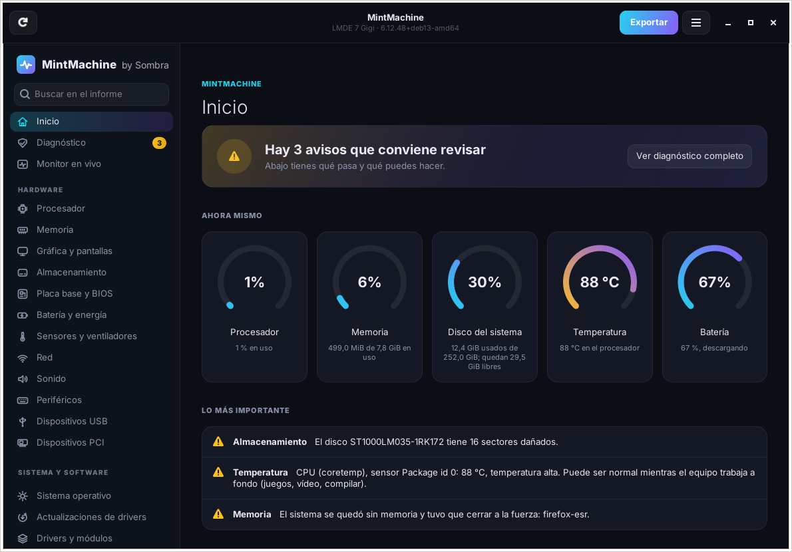
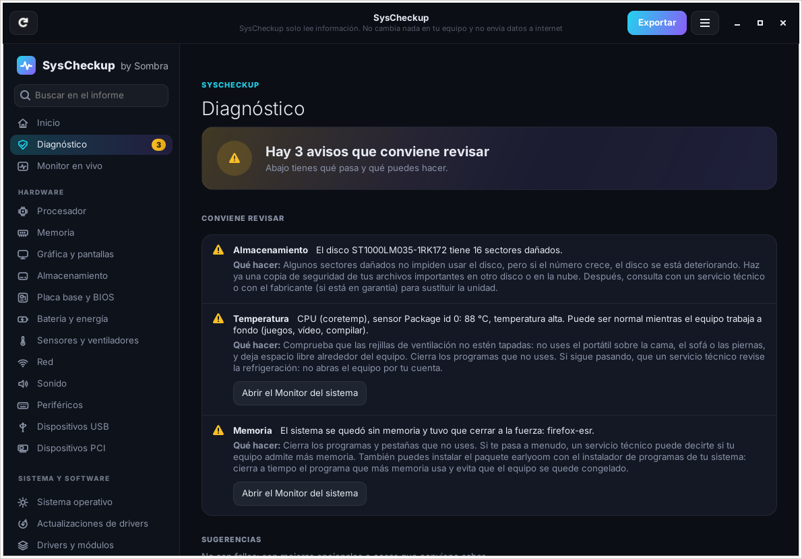
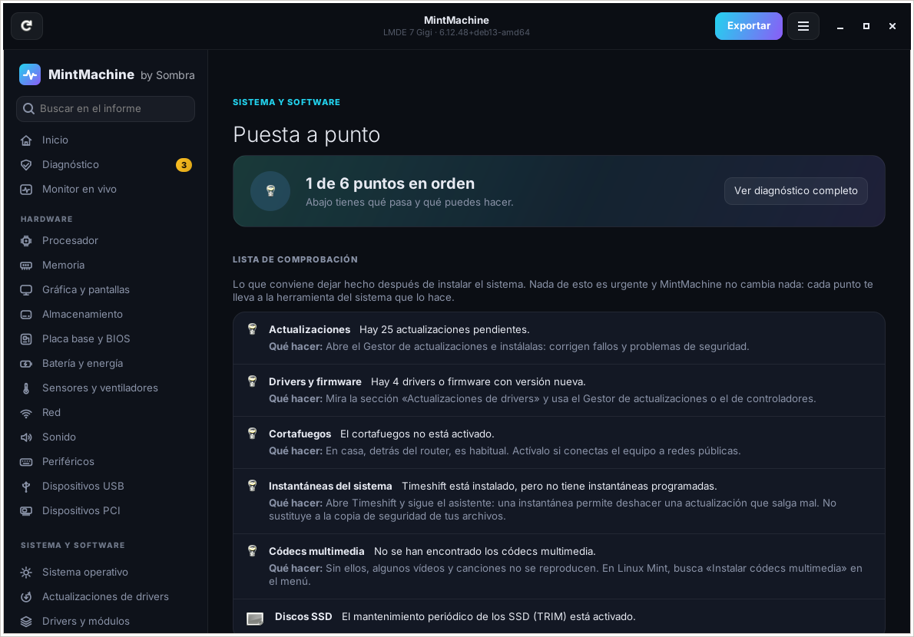
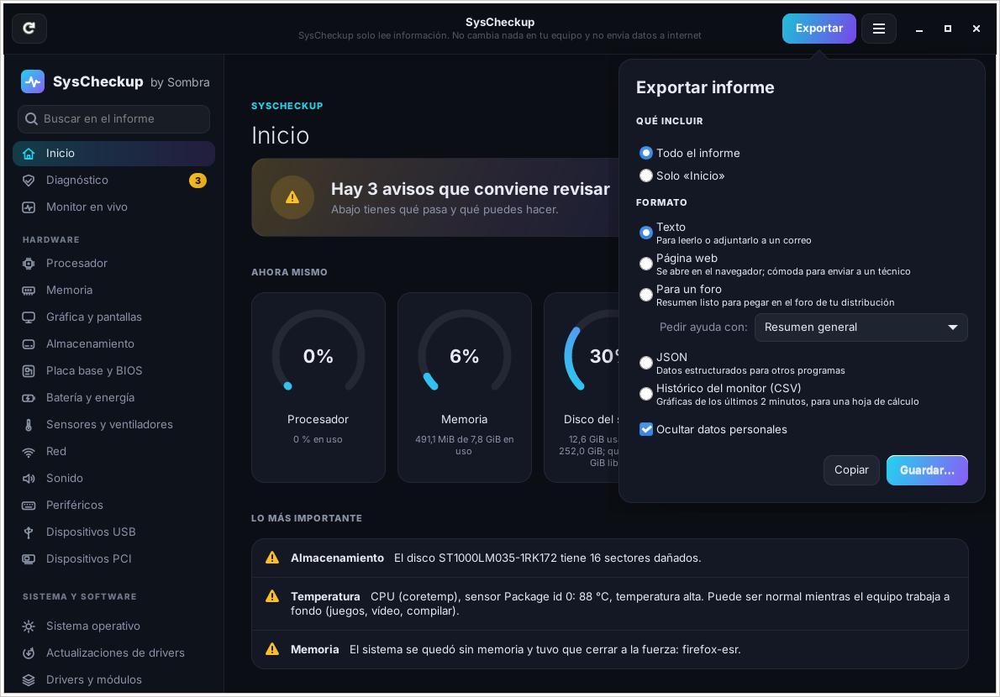
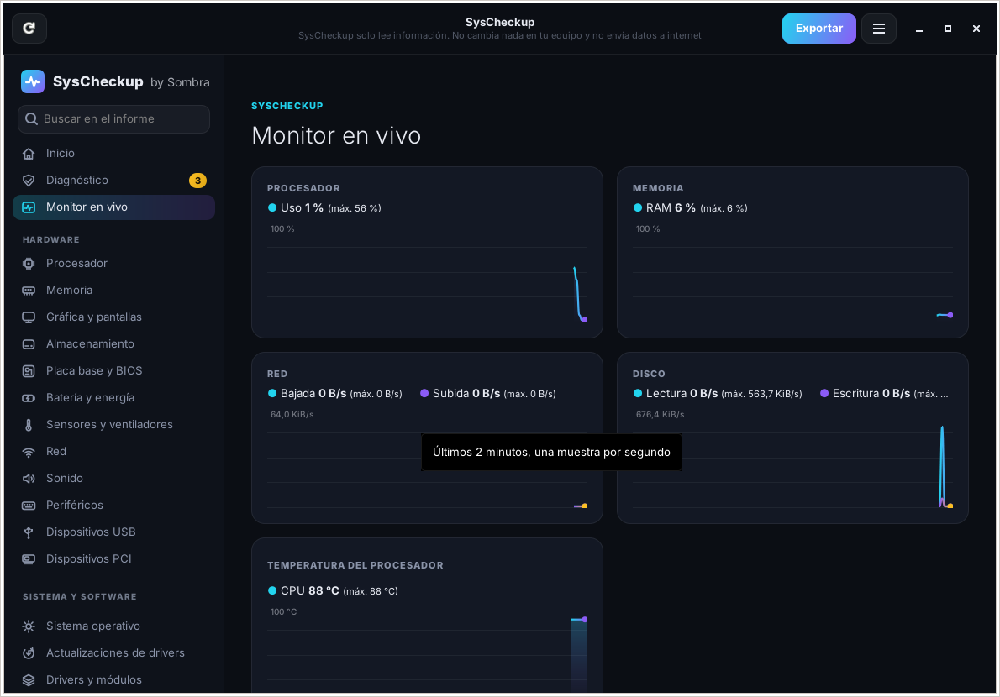

# SysCheckup

[Versión en español](README.es.md) · [Changelog](CHANGELOG.md)

Your Linux computer's hardware, drivers and software in a single window, with live usage graphs, a driver and firmware check, a diagnosis that points out what's worth looking at, and voluntary stability and performance tests.

Works on Linux Mint, LMDE, Ubuntu, Debian and any distribution based on them, with any desktop (Cinnamon, GNOME, KDE Plasma, Xfce, MATE, LXQt…), on X11 and Wayland. Available in Spanish, English, French, Japanese and Chinese.

Author: José Antonio Ramos Miralles «Sombra» <hola@joseantonioramos.es>. MIT license.



The screenshots in `docs/` come from the test bench, which simulates a laptop. The data shown in them is made up. They show the program in Spanish; it opens in your system's language.

## Distributions and desktops

SysCheckup only needs Python 3 and GTK 3, which every Debian-based distribution ships, and it recognises where it is running:

- **System tools.** The diagnosis buttons open whichever tool is installed: on Linux Mint, Update Manager, Driver Manager and Software Manager; on Ubuntu, Software Updater, "Additional Drivers" and App Center; on GNOME, the Software app; on KDE Plasma, Discover; if there is none of these, Synaptic. The same goes for each desktop's system monitor, power settings, Disks or disk usage analyzer. If there is no graphical tool of that kind, the advice says it in words and no button is shown.
- **Texts.** The advice names the tool you have. Advice that only applies to one distribution (multimedia codecs, Linux Mint's kernel menu) changes with the distribution.
- **Packages.** The tests suggest the package that exists in your repositories (`7zip` or `p7zip-full`; `glmark2-x11`, `glmark2` or `glmark2-wayland`).
- **Displays on Wayland.** The current mode is requested from GNOME, Cinnamon, KDE Plasma or wlroots compositors, as explained below.

It has been checked with the test bench posing as LMDE with Cinnamon, Ubuntu with KDE Plasma on Wayland and Debian with Xfce, and with the package installed on Ubuntu 24.04. It has not been tested on every real desktop.

## Made for everyone

- **The first screen shows what matters:** whether the computer is fine or something needs checking, live usage gauges, the computer's summary (with motherboard and BIOS) and the system status.
- **Details live in the sidebar**, grouped into Hardware and System and software. What only interests experts is folded under **Technical details** inside each section.
- **Plain-language explanations** under the technical items.
- **Search** (Ctrl+F): type "temperature", "NVIDIA" or "battery" and the list keeps only the sections that mention it.

## Language and appearance


The program detects the system language and opens in it. It only looks at the language, not the country: `es_ES`, `es_MX` or `es_AR` → Spanish; `en_US` or `en_GB` → English; `fr_FR` or `fr_CA` → French; `ja_JP` → Japanese; `zh_CN` or `zh_TW` → Chinese (Simplified). If the system uses a language SysCheckup doesn't have yet, it opens in English.

In the menu (☰) you can pick another language and the appearance, dark (the default) or light. The choice is saved in `~/.config/syscheckup/config.json`, the only file the program creates in your home folder. From a terminal: `syscheckup --idioma en`.

The translations are ordinary `.po` files in the `po/` folder; they can be reviewed with Poedit or Weblate. They were made by an AI: they should be reviewed by native speakers, especially Japanese and Chinese. To display Japanese and Chinese properly you need fonts with those characters (package `fonts-noto-cjk`, which Linux Mint installs when you add those languages).

## Safe recommendations

SysCheckup only reads information: it changes nothing on the computer. The diagnosis explains what is going on and what to do, and only suggests safe actions from the system itself: install updates, open Driver Manager, make a backup, free up space… When a warning has a related system tool, a button to open it appears.

It never asks you to open the computer or touch components. If something needs a physical check (internal cleaning, replacing a disk, the memory or the battery), the recommendation is to go to a repair service or the manufacturer. This notice also appears in the Diagnosis, in "About" and in exported reports.



## What it shows

Twenty-one sections in the sidebar:

| Section | Contents |
|---|---|
| Home | Overall status, live gauges (processor, memory, disk, temperature, battery), the most important diagnosis items, computer summary with motherboard and BIOS, and system |
| Diagnosis | Automatic check: what should be looked at, optional suggestions, what to do in each case, and the most repeated errors in the system log |
| Live monitor | Graphs of the last two minutes of processor, RAM and swap, network, disk, temperature and graphics; usage of each thread; programs using the graphics card; peaks reached since you opened the program; processes using the most |
| Processor | Live gauges for total usage, average frequency and temperature, with one bar per thread updated every second; model, family and stepping, microcode, cores and threads, P- and E-cores, caches, instruction sets, frequency and usage of each thread, thermal throttling, vulnerabilities and mitigations. With your password, if you ask: base frequency and multipliers, performance states and power draw in watts. Optional stability and performance tests |
| Motherboard and BIOS | Computer and board manufacturer and model, BIOS version and date, UEFI or legacy, Secure Boot, TPM |
| Memory | RAM and swap usage, installed modules slot by slot with their manufacturer (if the board doesn't report it, it is worked out from the JEDEC code or the module part number), free slots, maximum the board supports, corrected memory errors, out-of-memory protection. With your password, if you ask: timings, XMP profiles, chip manufacturer and manufacturing date, read from the modules themselves. Optional memory test |
| Graphics and displays | Cards, driver in use, clock, temperature, power draw and its limit, what is limiting it (power, temperature…), card BIOS, video memory and its manufacturer, Resizable BAR, PCIe link, OpenGL and Vulkan, video formats decoded in hardware, monitors and current mode. Optional performance and sustained load tests |
| Storage | Space used; SMART health, SSD wear, temperature and power-on hours; day-by-day health history of each disk; drives with model, type, interface, PCIe link and firmware; partitions and encryption; TRIM. Optional speed test |
| Network | Interfaces with driver, MAC, IP and speed; Wi-Fi with signal quality and band; gateway, DNS, Bluetooth |
| Sound | Sound cards and audio server |
| USB devices | What is connected, with speed, power draw and driver |
| PCI devices | All devices and the driver each one uses |
| Peripherals | Monitors (brand, model, size, native resolution and refresh rate, current mode, year of manufacture and serial number, read from the monitor's own EDID), keyboards, mice, touchpads, gamepads, cameras, printers and paired Bluetooth devices |
| Sensors and fans | Temperatures, fans in RPM and percent, who controls them, programmed curves, firmware thermal thresholds, voltages and power |
| Battery and power | Charge, health compared with factory capacity, cycles, power draw, charge limit, suspend type, hibernation; battery of wireless mice and keyboards; USB power supplies (Corsair HXi, RMi, AXi) |
| Operating system | Distribution and base, installation date, kernel, desktop, boot time and what slows it down |
| Drivers and modules | Loaded kernel modules, which are proprietary or out-of-tree, DKMS, kernel taint flags |
| Driver updates | Installed and available version of the kernel, NVIDIA driver, Mesa, firmware, microcode and DKMS; BIOS, SSD and peripheral firmware; devices without a driver; missing firmware |
| Software | Installed packages, versions of key components, pending updates, latest changes, Flatpak, startup programs, repositories |
| Security | Secure Boot, TPM, firmware security level (HSI), disk encryption, firewall, AppArmor, open ports, SSH |
| Setup checklist | What is worth having done after installing the system: updates, drivers and firmware, firewall, Timeshift snapshots, SSD TRIM and multimedia codecs. Each item leads to the system tool that does it |



## Voluntary tests

The Processor, Memory, Graphics and displays and Storage tabs have an **Voluntary tests** area at the end. No test runs on its own: you have to press the button, read the warning, tick "I have read the warning and want to run the test" and press **Start**.

| Test | What it does | Tool used |
|---|---|---|
| Processor stability (1, 10 or 60 min) | All cores at full load with varied calculations, checking that the results are correct | `stress-ng` (without it, a light Python test that detects less) |
| Processor performance (2–3 min) | Score compressing and decompressing, with one core and with all | `7z b` (package `7zip`) |
| Memory (1, 10 or 30 min) | Writes and checks patterns in half of the free memory | `stress-ng` |
| Graphics performance (about 5 min) | 3D scenes in a window and a score | `glmark2` |
| Graphics sustained load (1, 10 or 30 min) | Keeps the graphics card working to see whether it is stable | `glmark2` |
| Disk speed | Writes 1 GiB to your home folder, reads it and deletes it | `dd` |

While it runs, a window shows the time left, the temperature and its graph, the frequency and the usage, with a **Stop** button. The test stops on its own if:

- the processor temperature comes within 5 °C of the maximum it declares (90 °C on AMD and 95 °C on Intel if it doesn't declare one), or the graphics card within 10 °C of its maximum (87 °C if it doesn't declare one);
- the laptop is unplugged (on battery it won't start, nor with less than 30 % charge);
- SysCheckup is closed.

Each test runs in its own process group and also has its own time limit, so it can never be left running on its own. At the end you see the result: passed, with errors (calculation failures or new hardware errors in the kernel log), stopped because of temperature… with the maximum temperature, the sustained frequency and how many times the processor throttled because of heat. Scores are compared with your previous measurements; SysCheckup sends nothing to the internet, so there is no comparison with other computers.

Results are saved in `~/.config/syscheckup/historial.json` and appear in the "Tests you have run" table of each tab and in exported reports.

## Internal memory and processor data

Everything the system lets your user read is read without a password, and the password is only needed for what truly requires it:

- **Without a password:** the processor's base, maximum and minimum frequency with their multipliers (from `cpufreq`); the memory module data when the kernel already publishes it (the `ee1004` and `spd5118` drivers load automatically on many boards, and then any user can read their data); and the processor's power draw in watts, live, if your system lets its counters be read.
- **With a password:** only what's missing. In the Memory tab the button only appears if your system doesn't publish the module data. In the Processor tab, only if there is something left that only the administrator can read: the power draw in watts (since Linux 5.10, for security reasons, its counters are root-only) and, on AMD, the performance states.

Next to each test and internal-data button there is an "i": pressing it explains what it does, how long it takes, which tool it uses, whether it asks for a password and when it stops on its own.

The **Read internal data…** button (when pressed, the system asks for your password) reads what the components themselves store and the system only shows to the administrator:

- **Memory (SPD):** module and chip manufacturer, part number, manufacturing date, default speed and timings (CL-tRCD-tRP-tRAS) and the manufacturer profiles (XMP). If the memory runs at the standard speed and its profiles allow more, it says so. Works with DDR4 and DDR5 when the board exposes this data to the system (kernel drivers `ee1004` and `spd5118`; on Ubuntu 24.04 DDR5 needs the HWE kernel).
- **Processor:** base frequency and multipliers, performance states (AMD) and maximum turbo (Intel), and the processor's power draw measured over one second.

This is done by a separate helper, `/usr/libexec/syscheckup/syscheckup-probe`, launched with `pkexec` only when you press the button. It only reads: it copies the data published by the kernel drivers, without using `/dev/i2c-*` or writing to the memory bus, reads a closed list of processor registers and accepts no other arguments. If it has to load a kernel module (`ee1004`, `spd5118` or `msr`), it unloads it when done. Memory data is only shown if it passes its checksum.

The position of each field in the SPD chip follows the JEDEC standards and has been checked against `decode-dimms` (DDR4) and memtest86+ (DDR4 and DDR5, XMP profiles). DDR5 and XMP profiles have not yet been tested with real modules.

## Export

A single button, **Export**, with every option:



- **What to include:** the whole report or only the section you are viewing.
- **Format:**
  - **Text**, to read it or attach it to an email.
  - **Web page**, which opens in the browser and is handy to send to a technician.
  - **For a forum**, a summary between `[code]` and `[/code]` ready to paste into the Linux Mint forum. Under "Ask for help with" you can choose the problem (Wi-Fi and network, sound, graphics and displays, battery and temperature, slowness and boot): the summary then carries the computer summary and only the sections needed for that problem, with their technical details.
  - **JSON**, to process the data with another program.
  - **Monitor history (CSV)**, the graphs of the last two minutes to open in a spreadsheet.
- **Hide personal data**, ticked by default: masks serial numbers, MAC, IP, disk UUIDs, computer name, Wi-Fi network, user name and Bluetooth device names, also when they appear inside other texts, such as the system log.
- **Copy** to the clipboard or **Save** to a file. After saving, a button to open it appears.

Reports always include everything, including what is folded under "Technical details" in the window.

## Buttons and shortcuts

| | |
|---|---|
| Circular arrow, F5 or Ctrl+R | Read the whole computer again |
| Ctrl+F | Search the whole report |
| Ctrl+E | Export |
| Alt+1 … Alt+9 | Go to one of the first nine sections in the list |
| Menu (☰) | Language, appearance (dark or light), hide personal data on screen (for screenshots), keyboard shortcuts, About and Uninstall |
| F1 | About |
| Ctrl+Q | Quit |

## Live monitor



SysCheckup takes one sample per second from start-up and keeps the last two minutes. The graphs are drawn with real kernel data:

- **Processor:** total usage and one bar per thread, computed from `/proc/stat`.
- **Memory:** RAM actually in use (total minus available) and swap.
- **Network:** download and upload, adding up the physical interfaces.
- **Disk:** read and write across all drives, from `/proc/diskstats`.
- **Processor temperature:** the hottest CPU sensor.
- **Graphics:** GPU usage on AMD, NVIDIA and Intel cards. Intel doesn't publish a percentage, so it is computed from the time the GPU spends idle (RC6); on laptops with two GPUs both lines are shown.
- **Programs using the graphics card:** the kernel publishes each program's GPU time in `/proc/<pid>/fdinfo` (AMD, Intel and the open NVIDIA driver); with NVIDIA's proprietary driver it comes from `nvidia-smi pmon`. Only your own programs are shown.
- **Session peaks:** the highest processor usage and temperature, memory and graphics values reached since you opened SysCheckup, with the time.

Each graph shows the current value and the maximum of the last two minutes. Below are two tables with the processes using the most processor and memory, and the system pressure (PSI): the percentage of time programs spend waiting for CPU, memory or disk.

## Monitors and power supply


Monitor data comes from its EDID, the data sheet the monitor itself sends over the cable. The kernel publishes it in `/sys/class/drm`; with NVIDIA's proprietary driver it doesn't always do so, and then SysCheckup reads it from `xrandr --verbose`.

A desktop power supply doesn't tell the computer its brand, model or wattage, so no program can read them. The only ones that do are "smart" power supplies with an internal USB cable; of these, Linux has a driver for the Corsair HXi, RMi and AXi (`corsair-psu`), and SysCheckup shows their model, the power they deliver, the temperature and the fan. To find out which one you have, check the invoice or the box; don't open the computer to read the label.

## Fans and curves

This is what Linux lets you know about a fan, and SysCheckup shows all of it:

| Data | Where it comes from | Availability |
|---|---|---|
| Speed in RPM | `fanN_input` | Almost always, if the kernel has a driver for the chip |
| Power in % | `pwmN`, from 0 to 255 | Desktop boards and quite a few laptops |
| Who controls it | `pwmN_enable`: 0 full speed, 1 manual, 2 or more automatic | Wherever `pwmN` exists |
| Temperature → power curve | `pwmN_auto_pointM_temp` and `_pwm` | Only if the chip publishes it |
| Firmware thresholds | ACPI thermal zones | Almost all laptops |

The curve you set in the BIOS is stored in the board's controller chip, and most drivers don't let you read it. SysCheckup shows it when it exists: some boards with Nuvoton or ITE chips, ASUS ROG laptops with custom curves, and AMD graphics cards. On other computers you'll see the ACPI thresholds, which tell at what temperature the firmware speeds up the fan, throttles the processor or shuts the computer down.

SysCheckup only reads. To change curves from Linux there is CoolerControl, with a graphical interface, and `fancontrol`, from the `lm-sensors` package.

## How it checks whether drivers are up to date

On Windows each driver is installed and updated separately. On Linux almost all of them ship inside the kernel, so the useful question is a different one: whether you have the latest kernel your distribution offers. SysCheckup checks four things.

1. **Packages.** It compares the installed version with the one your repositories offer for the kernel, the NVIDIA driver, Mesa, firmware packages, processor microcode and DKMS modules.
2. **Device firmware.** If `fwupd` is present, it lists BIOS, SSD, docks and peripherals with their version and warns when the manufacturer has published a new one.
3. **Devices without a driver.** It points out PCI hardware that has no module loaded.
4. **Missing firmware.** It searches the kernel log for files a driver asked for and didn't find, and says which device they belong to and which package provides them. It doesn't warn about those no distribution includes because they are optional, such as `iwl-debug-yoyo.bin` for Intel Wi-Fi.

It also warns if you already have a newer kernel installed and a reboot is pending, and if the package list hasn't been refreshed for more than ten days.

The comparison is made against your system's repositories and without connecting to the internet. If NVIDIA publishes a driver today that Debian hasn't packaged yet, SysCheckup won't know.

## Diagnosis

Besides reading, it interprets. It warns about:

- Disks over 90 % full, with bad sectors, with imminent SMART failure or with almost no estimated life left.
- Disk errors, processor hardware errors and out-of-memory kills in the kernel log.
- High temperatures and thermal throttling of the processor.
- A worn battery.
- systemd services that failed to start.
- A single RAM module on a board with two slots, and memory errors.
- Graphics without a driver or 3D rendered in software.
- Unmitigated CPU vulnerabilities.
- Weak Wi-Fi signal.
- New driver and firmware versions, pending updates and pending reboots.

Each warning says what to do and, if one exists, offers a button to open the system tool: Update Manager, Driver Manager, Backups, Timeshift, Disk Usage Analyzer, Disks, Firewall, Firmware, System Monitor or System Reports. The button only appears if the tool is installed. SysCheckup never runs anything as administrator: if the tool needs privileges, the tool itself asks for the password.

## Uninstall

Menu (☰) → **Uninstall SysCheckup…**. It removes the program, its menu icon, its settings and its history, leaving no trace. The system asks for your password, as with any uninstall. Reports you have saved are yours and are not touched.

From a terminal it does the same: `sudo apt purge syscheckup` and then `rm -rf ~/.config/syscheckup ~/.cache/syscheckup`.

## Installation

Download the `.deb` and, from the folder where you saved it:

```
sudo apt install ./syscheckup_0.7.1_all.deb
```

`apt` installs any missing dependencies. You'll then find it in the menu as SysCheckup. If you had an earlier version, this package updates it; if you had one of the test versions called MintMachine, or the first one, called Radiografía, it replaces it. MintMachine's settings and history move to the new folder automatically.

To remove it, see the "Uninstall" section.

### Without installing

The program is a single Python file:

```
python3 syscheckup.py
```

It needs `python3-gi`, `python3-gi-cairo` and `gir1.2-gtk-3.0`, which Mint and LMDE ship by default.

## Command line

```
syscheckup                       opens the window
syscheckup --texto               full report in the terminal
syscheckup --foro                summary to paste into a forum, with personal data hidden
syscheckup --foro --problema red summary focused on one problem: red, sonido, grafica, energia or lentitud
syscheckup --txt informe.txt     saves the full report as text
syscheckup --html informe.html   saves the report as HTML
syscheckup --json                dumps the data as JSON
syscheckup --csv monitor.csv     measures for two minutes and saves the monitor history
syscheckup --texto --anon        any of the above with --anon hides personal data
syscheckup --idioma en           any of the above in another language (es, en, fr, ja, zh)
syscheckup --texto --debug       also shows which tools are run and how long each takes
```

The option names are in Spanish (`--texto` = text, `--foro` = forum, `--problema` = problem; `red` = network, `sonido` = sound, `grafica` = graphics, `energia` = power, `lentitud` = slowness).

Without a graphical session, for example over SSH, the program switches to text mode by itself.

## Privacy

SysCheckup opens no internet connection. It reads files from `/proc` and `/sys` and runs tools already on your system. It only asks for the administrator password if you choose "Read internal data" or "Uninstall". Reports stay wherever you save them.

When exporting, "Hide personal data" is ticked. Still, review the report before publishing it: masking looks for the data the program knows and the usual formats (MAC, IP, UUID), but it can't guess every piece of personal data that may appear in a file or device name.

What the code guarantees, and the automated tests check on every change:

- It imports no network module. The only network function it uses is the one that returns the computer's name.
- In your home folder it only writes inside `~/.config/syscheckup/`: `config.json` (language and theme) and `historial.json` (one daily measurement of each disk's health, the results of the tests you run and the internal data you read). Disks are identified by a fingerprint, not by their serial number. The disk speed test creates a temporary file in `~/.cache/syscheckup/` and deletes it when done.
- It only asks for the password if you choose "Read internal data" or "Uninstall". The helper it uses for internal data only reads.
- `--debug` writes the name of each tool and its options to the terminal, never its arguments or its output, and creates no file.
- From the Timeshift settings it only checks whether there are scheduled snapshots; from the Wayland desktop, only the connector and mode of each display.
- With "Hide personal data" the names of printers and of Bluetooth keyboards and mice, which may carry a person's name, are masked too.

## Where each piece of data comes from

| Data | Source |
|---|---|
| Processor | `/proc/cpuinfo`, `/proc/stat`, `/sys/devices/system/cpu` |
| Board and BIOS | `/sys/class/dmi/id` |
| Secure Boot, TPM | `/sys/firmware/efi/efivars`, `/sys/class/tpm` |
| RAM modules | `udevadm info` on the DMI node, without root |
| Internal memory data | `/sys/bus/i2c/drivers/ee1004/*/eeprom` and `…/spd5118/*/eeprom`, with the helper and your password |
| Processor multipliers and power draw | MSR registers (`/dev/cpu/0/msr`) and `/sys/class/powercap/intel-rapl:*/energy_uj`, with the helper and your password |
| Graphics limits, temperature and power | AMD: `/sys/class/drm/card*/device/gpu_metrics` and `hwmon`; NVIDIA: `nvidia-smi` |
| Resizable BAR | Size of the card's PCI memory windows (`resource`) compared with its video memory |
| Out-of-memory protection | `systemctl is-active` for systemd-oomd, earlyoom and nohang |
| Graphics and video | `lspci`, `glxinfo`, `vainfo`, `vulkaninfo`, `nvidia-smi` |
| Monitors | EDID in `/sys/class/drm` or, with NVIDIA, `xrandr --verbose` |
| Current display mode | X11: `xrandr`. Wayland: desktop D-Bus (GNOME, Cinnamon), `kscreen-doctor -j` (KDE), `wlr-randr --json` (wlroots) |
| Intel GPU usage | `/sys/class/drm/card*/gt/gt0/rc6_residency_ms` (i915) or `…/gtidle/idle_residency_ms` (xe) |
| Application of each process | `/proc/<pid>/cgroup` and the executable name |
| Power profile and governor | `powerprofilesctl`, `/sys/firmware/acpi/platform_profile`, `/sys/devices/system/cpu/*/cpufreq` |
| Compressed memory | `/sys/block/zram*`, `/sys/module/zswap` |
| Firmware security (HSI) | `HostSecurityId` property of the fwupd service, with `gdbus` |
| Setup checklist | Data from the other sections and `/etc/timeshift/timeshift.json` |
| Power supply | `/sys/class/hwmon` (`corsair-psu` driver) |
| Disks | `lsblk`, `statvfs`, `/proc/diskstats` |
| SMART | `udisksctl dump`: the UDisks service has already read the data and offers it without root |
| SSD wear | `gdbus call` to UDisks `SmartGetAttributes` (NVMe and SATA) |
| PCIe link, graphics clock | `/sys/bus/pci/devices/*/current_link_*`, `/sys/class/drm/card*` |
| Network | `/sys/class/net`, `ip`, `iw` |
| Sensors and fans | `/sys/class/hwmon`, `/sys/class/thermal`, `/proc/acpi/ibm/fan` |
| Battery and suspend | `/sys/class/power_supply`, `/sys/power` |
| Processes | `/proc/<pid>/stat` |
| Kernel modules | `/proc/modules`, `/sys/module`, `dkms` |
| Driver versions | `dpkg-query`, `apt-cache policy` |
| Firmware | `fwupdmgr get-devices` and `get-updates` |
| Software | `apt`, `flatpak`, `/var/log/dpkg.log` |
| Services and log | `systemctl`, `systemd-analyze`, `journalctl` |

If a tool is missing, the corresponding section comes out shorter and everything else keeps working. A failure reading one section doesn't bring down the others either.

## Project status

Version 0.7.1. It's worth knowing how it has been tested.

The code has been run in a virtual machine with Ubuntu 24.04, in a container with the LMDE 7 packages and against a simulated laptop: a fake `/sys` with board, battery, sensors, fans with PWM and a curve, monitor, Wi-Fi and USB, plus fake versions of `lspci`, `lsblk`, `udisksctl`, `gdbus`, `fwupdmgr`, `apt-cache` and friends. With that, all the parsers, the graphs under real CPU and disk load, the live refresh, search, buttons, personal-data masking and the five export formats have been checked.

What's missing is mileage on real hardware. The test bench formats are written by hand from each tool's documentation, and a real computer always brings some quirk. If a section comes out empty or with odd data on your machine, open an issue and paste the output of `syscheckup --texto --anon`.

### Known limitations

- **BIOS curves.** Only visible when the chip's driver publishes them. Explained above.
- **Drivers newer than those in the repository.** The comparison doesn't leave your system.
- **SMART and NVMe wear.** Needs UDisks 2.10 or later. Linux Mint 22 and LMDE 7 ship it; LMDE 6 ships 2.9 and will only give SMART for SATA disks.
- **AI-made translations.** English and French should be correct; Japanese and Chinese should be reviewed by a native speaker.
- **SSD wear not tested on real hardware.** The UDisks response is written from its documentation. If the "Lifespan" column is empty for your SSD, open an issue.
- **SMART detail.** Status, temperature, hours and bad sectors are shown. The full attribute table still needs `sudo smartctl -a`.
- **Kernel log.** To read it, your user must belong to the `adm` group. The first user on Mint usually does.
- **Intel GPU usage.** An estimate based on the GPU's idle time, not yet tested on real hardware.
- **Internal memory data.** Depends on the board publishing the SPD to the system; many do, some don't. DDR4 reading has been checked against `decode-dimms`; DDR5 and XMP profiles follow memtest86+'s offsets and have not yet been tested with real modules. EXPO profiles are detected, but their timings are not read.
- **Processor multipliers.** Read on AMD Ryzen (Zen 1 to Zen 5) and Intel. The voltage the processor requests is not shown: its encoding changes with the generation and is not verified.
- **Graphics limit reasons.** On AMD only for the `gpu_metrics` versions SysCheckup knows (those of consumer Radeon cards and recent integrated GPUs); for others the row is not shown.
- **Tests.** Stress and performance tests have been run in a virtual machine without temperature sensors and with software rendering; the temperature and battery cut-offs have been tested with simulated data.
- **Wayland.** The current display mode is requested from the desktop: GNOME and Cinnamon via D-Bus, KDE Plasma with `kscreen-doctor` and Sway, Hyprland and similar with `wlr-randr`. Checked with sample responses, not on every real desktop; on other compositors the monitor's data sheet is shown without the current mode.
- **Monitor applications.** GNOME, KDE, Flatpak and Snap give the exact name of each application; on Cinnamon they are grouped by executable, so several Python programs appear together as `python3`.
- **Distributions without `.deb`.** The program works, but the package inventory and the driver check come out empty.

## How it's built

One file, `syscheckup.py`, in five parts:

1. **Utilities.** `read()` reads a file and returns an empty string if it fails. `run()` runs a command with a time limit and a fixed locale, and also returns an empty string if the command doesn't exist.
2. **Sampler.** The `Sampler` class takes one sample per second and keeps the history the graphs draw.
3. **Collectors.** One `sec_*` function per section. Each returns blocks of eight kinds: `kv` (key-value pairs), `table`, `bars`, `chart`, `cores`, `note`, `status` and `findings`. With `adv=True` a block is a technical detail and the window folds it; with `help="..."` it carries a plain-language explanation.
4. **Exporters.** `to_text`, `to_html`, `to_json`, `to_forum` and `to_csv`, registered in `EXPORTERS`.
5. **GTK 3 interface.** Draws the same blocks; the graphs are drawn with cairo. The initial read runs in a separate thread so the window doesn't freeze.

Texts are written in Spanish inside `_()`; those carrying data, as a template: `_("Quedan {n} libres").format(n=...)`. Titles, keys, headers, notes and fixed values passed to `kv`, `table`, `bars`, `note` and `section` are translated automatically. To add or change texts: edit the code, regenerate `po/syscheckup.pot` and complete the `.po` files (`msgmerge` is the tool for that). Comments and internal names in the code are in Spanish.

The collectors share a `Ctx` object. With `ctx.flag(level, area, text, what_to_do, action)` any of them leaves a warning that the Diagnosis then collects. `action` is a key of `ACTIONS`, the list of system tools that can be opened. **Rule for warnings:** "what to do" may only suggest safe actions from the system; any physical check is referred to a repair service or the manufacturer.

Values wrapped in `Sens(...)` are masked when personal data is hidden, and they are also searched for inside the rest of the report's texts.

### Adding a section

```python
def sec_ejemplo(ctx):
    filas = []
    for p in sorted(glob.glob("/sys/class/leds/*")):
        filas.append((os.path.basename(p), read(p + "/brightness")))
    return section("leds", "Luces", [
        table("LED del equipo", ["Nombre", "Brillo"], filas),
    ])
```

Then register it in `COLLECTORS`, `ORDER` and `TITLES`. With that it appears in the window, in text mode and in every export format. If you want it to refresh by itself, add its identifier to `LIVE`.

## Building the .deb package

```
packaging/build-deb.sh
```

The package ends up in `dist/`. Only `dpkg-deb` is needed. The version is taken from the `VERSION` variable in `syscheckup.py`. The package's "Maintainer" field only says "SysCheckup", with no personal data: dpkg requires it and, if it's missing, apt shows a warning every time it's used.

On GitHub, the `.github/workflows/ci.yml` action tests the program and builds the `.deb` on every change. When a `v0.7.0` tag is pushed, it attaches the `.deb` to that release.

## Tests

The test bench mounts a simulated `/sys` inside a private mount namespace, so your computer's real `/sys` is not touched. It needs root for the mount:

```
sudo tests/run.sh texto
sudo tests/run.sh texto --anon
sudo tests/run.sh html /tmp/informe.html
sudo tests/run.sh foro /tmp/foro.txt --anon        (also json and csv)
sudo -E tests/run.sh gui /tmp/captura.png resumen   (screenshot of the window, then exits)
```

There are also unit tests, which don't need root: they check the parsers (EDID, Wayland displays, applications, Intel GPU), personal-data masking, that the code doesn't use the network and that the translations are complete.

```
python3 -m pytest tests/test_unidad.py      (without pytest: python3 tests/test_unidad.py)
```

To try a new case, for example a stopped fan or a disk with a SMART failure, change the values in `tests/simular_portatil.py` and see what the Diagnosis says. With `MM_IDIOMA=en` (or `fr`, `ja`, `zh`) in front, the test bench runs in that language; with `MM_FUENTE=1`, it simulates a Corsair power supply with USB.

## Publishing it on GitHub

1. Create an empty repository on GitHub, without a README or license: they are already included.
2. From the project folder:

```
git init
git add .
git commit -m "SysCheckup 0.7.0"
git branch -M main
git remote add origin https://github.com/YOUR-USER/syscheckup.git
git push -u origin main
git tag v0.7.0
git push origin v0.7.0
```

3. The GitHub action builds the `.deb` and attaches it to release `v0.7.0`. If you prefer to do it by hand, create release `v0.7.0` under Releases and attach `syscheckup_0.7.0_all.deb`.
4. Once you have the repository address, add it to `data/syscheckup.metainfo.xml` with `<url type="homepage">…</url>`.

Issues use the templates in `.github/ISSUE_TEMPLATE`, which ask for the forum report with personal data hidden.

The `build/` and `dist/` folders are in `.gitignore`. The `.deb` is uploaded as a release asset and stays out of the history.

A note about the name: "Linux Mint" is a trademark of its project. Make it clear in the repository description that SysCheckup is an independent program.

## Ideas for future versions

- GPU usage per process (DRM fdinfo, without root for your own processes).
- Draw the fan curve as a graph, with a dot marking where it is now.
- Optional check against the internet: latest stable kernel and latest NVIDIA driver published.
- Desktop alerts when a temperature or a disk crosses a threshold.
- Keep the graph history between sessions.
- Compare two JSON reports to see what has changed on the computer.
- GPU usage per process and processor power draw (RAPL), which currently need root.
- Tray icon with temperature and usage.
- Split the code into modules and load each section when it's opened, so it starts faster.
- "Why is my computer slow?" assistant, health score by area and a report for selling or buying a second-hand computer.
- Flatpak package.

## License

MIT, © 2026 José Antonio Ramos Miralles «Sombra». You may use, modify and redistribute it, including in commercial projects, as long as you keep the copyright notice. The full text is in `LICENSE`.

As the license says, the program is provided as is, without warranty. Its recommendations are guidance only: if in doubt about the hardware, consult a repair service or the manufacturer.
